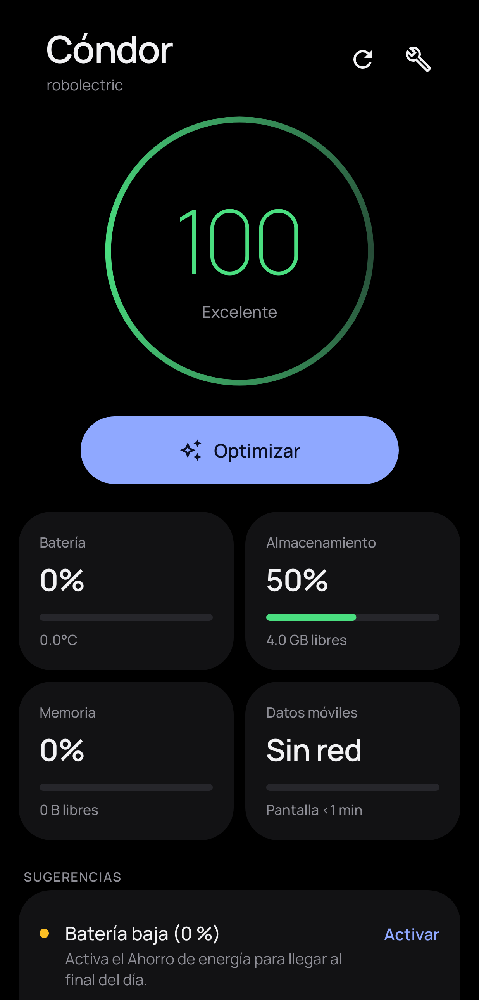
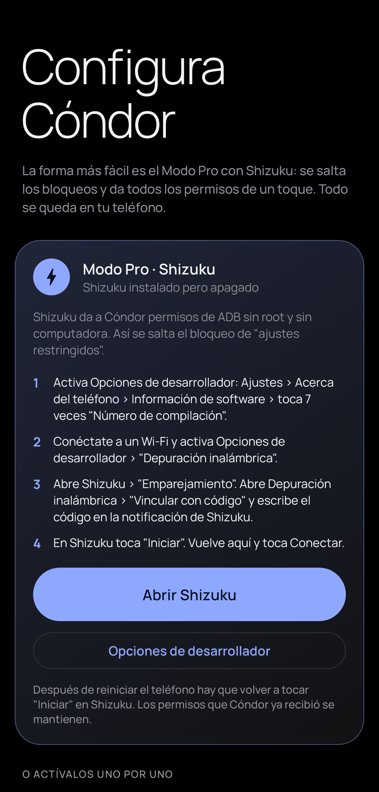
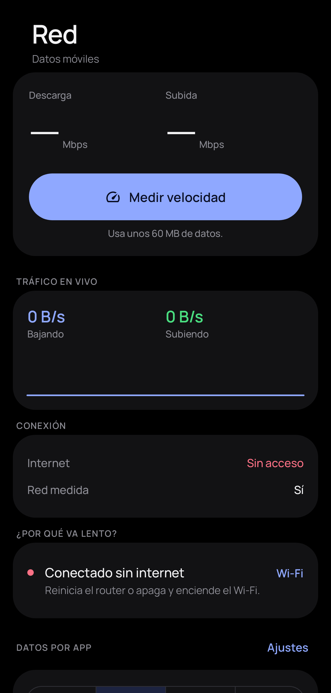
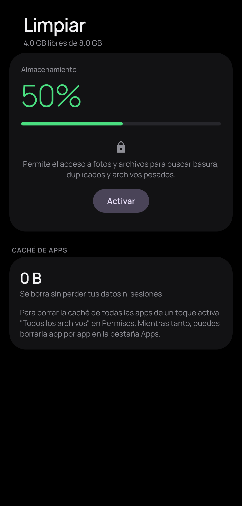

# Cóndor Care — optimizador inteligente para Samsung Galaxy S25 Ultra

App Android (Kotlin + Jetpack Compose, Material You) que analiza todo el teléfono, explica
qué gasta la batería y el internet, y limpia archivos basura.

**Descargar APK:** [`releases/CondorCare-3.0.0.apk`](releases/CondorCare-3.0.0.apk)

<p>
 
 
</p>

### Novedades 3.0 — Modo Pro con Shizuku
Con [Shizuku](https://shizuku.rikka.app/) (permisos de ADB sin root ni computadora) Cóndor:
- **Se da todos los permisos solo**, saltándose el bloqueo de "ajustes restringidos".
  Además recibe `DUMP` y `WRITE_SECURE_SETTINGS`, que se mantienen aunque reinicies.
- Muestra el **consumo real de batería en mAh** por app y por componente (pantalla, CPU, red móvil…),
  leído de `dumpsys batterystats`.
- Borra la **caché de todas las apps** de un toque (`pm trim-caches`).
- **Detiene**, **restringe en segundo plano** o **congela** cualquier app (y la descongela).
- Cambia la velocidad de las animaciones, recompila las apps para más fluidez, muestra la
  capacidad real de la batería (ASOC de Samsung) y reinicia el teléfono.

### Novedades 2.0
- Diseño minimalista nuevo: negro AMOLED, tipografía Manrope, barra flotante y animaciones.
- Configuración guiada de permisos, con los pasos para desbloquear los **ajustes restringidos**
  de Android y Samsung Auto Blocker.
- El limpiador funciona aunque no se conceda "Todos los archivos": busca en fotos, videos y audio
  (duplicados, archivos pesados, capturas viejas) y borra con la confirmación del sistema.
- La app funciona sin permisos (batería en vivo, prueba de velocidad, tamaño de apps); cada permiso
  solo desbloquea más funciones.

## Funciones

| Pestaña | Qué hace |
|---|---|
| **Inicio** | Puntuación de salud (0–100), botón **Optimizar ahora** (cierra procesos en 2º plano y borra basura segura), y un **asistente inteligente** con recomendaciones según lo que detecta. |
| **Batería** | Consumo **en vivo** (W y mA, con gráfica), tiempo restante estimado, salud, temperatura, voltaje y ciclos de carga. Ranking de **apps que más drenan** (24 h / 3 días / 7 días) con el motivo. Revisión de ajustes que gastan batería (brillo, 120 Hz, AOD, tiempo de pantalla, ubicación, Bluetooth, NFC…). |
| **Red** | Conexión actual (señal en dBm, banda 2.4/5/6 GHz, Wi-Fi 6E/7, VPN, ahorro de datos), tráfico en vivo, **prueba de velocidad** (descarga, subida, ping, jitter, DNS), consumo de datos **por app** (Wi-Fi/móvil, 1er/2º plano) y diagnóstico de **por qué va lento**. |
| **Limpiar** | Limpia la **caché de todas las apps** (diálogo oficial de Android), y busca temporales, logs, miniaturas, carpetas vacías, APKs, papeleras ocultas, descargas viejas, **duplicados** y archivos grandes. Nada se borra sin tu confirmación. |
| **Apps** | Tamaño, caché, último uso y tiempo de uso de cada app. Filtros por más pesadas, sin usar 30+ días, más caché, etc. Desinstalar con un toque. |
| **Herramientas** | Info del dispositivo (One UI, procesador, estado térmico, CPU en vivo), atajos a Device Care y ajustes Samsung, trucos de velocidad. |
| **Ajustes rápidos** | Botón **Optimizar** para la cortina de notificaciones. |

## Instalación en el S25 Ultra

1. Descarga el APK en el teléfono y ábrelo.
2. Si lo pide, permite **Instalar apps desconocidas** para el navegador o Mis Archivos.
3. Si aparece **Auto Blocker** (bloqueo automático), desactívalo temporalmente:
   Ajustes › Seguridad y privacidad › Auto Blocker.
4. Abre Cóndor Care y sigue la pantalla **Configura Cóndor**.
   Si un permiso sale en gris o como "Ajuste restringido": Información de la app › ⋮ ›
   **Permitir ajustes restringidos**, y vuelve a intentarlo.

## Limitaciones honestas de Android

- Android no deja que apps de terceros lean los mAh exactos por app. El ranking de batería es
  una **estimación** que combina tiempo en pantalla, trabajo en 2º plano y datos en 2º plano.
  El botón "Uso oficial" abre la pantalla de Samsung con los números del sistema.
- Desde Android 11 ninguna app puede borrar la caché de otras apps por su cuenta; se usa el diálogo
  oficial del sistema, que sí la borra toda de una vez.
- "Optimizar" cierra procesos en segundo plano que Android permite cerrar; los servicios del
  sistema se reinician solos.
- Todo funciona dentro del teléfono. Solo la prueba de velocidad se conecta a Cloudflare.

## Compilar

Requiere JDK 17+ y Android SDK 35.

```bash
./gradlew assembleRelease   # firma con keystore.properties si existe, si no con la clave debug
./gradlew testDebugUnitTest -Proborazzi.test.record=true   # capturas de cada pantalla en app/screens
```
